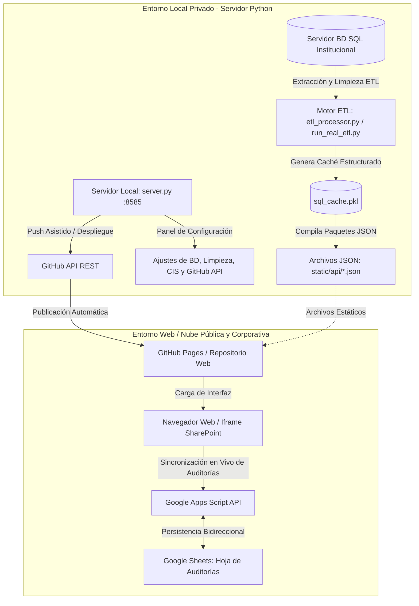
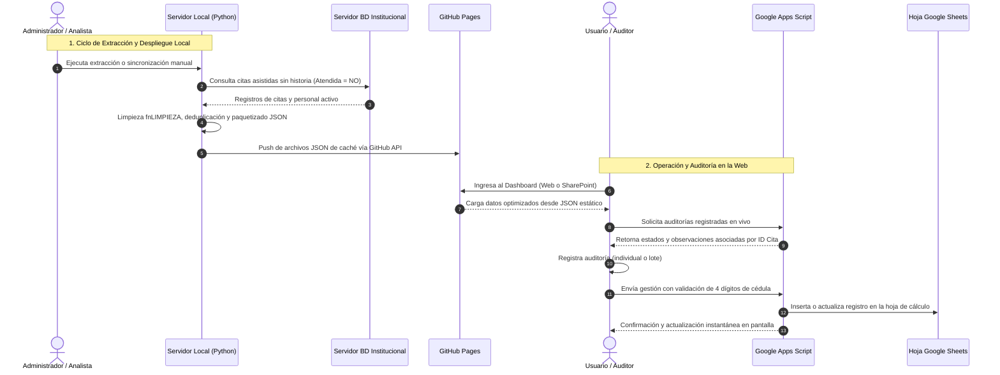

# Sistema Web de Seguimiento a Cierre de Historias Clínicas - AGENDAWEB

Aplicación web interactiva de alto rendimiento desarrollada para la gestión, auditoría y control del cierre de historias clínicas en **Unión para la Salud y la Vida S.A.S.** Esta plataforma reemplaza y amplía las capacidades del informe analítico institucional, proporcionando herramientas operativas de auditoría individual y masiva, filtros dinámicos en cascada, sincronización en tiempo real y una arquitectura desacoplada para despliegue local y en la nube.

---

## 🌟 1. Políticas Institucionales y Reglas de Negocio

El sistema opera bajo lineamientos claros orientados a la oportunidad y calidad en el registro de la atención en salud:

1. **Enfoque Exclusivo en Citas Sin Reporte de Atención**:
   - La base de datos y la interfaz se concentran **única y exclusivamente en citas confirmadas/asistidas que no cuentan con evidencia de historia clínica diligenciada** (`Atendida = NO`).
2. **Exclusión de Códigos de Servicio Especiales**:
   - Se excluyen automáticamente del cómputo y de las tablas aquellos servicios asistenciales o administrativos parametrizados que no requieren el diligenciamiento de una historia clínica estándar bajo esta modalidad.
3. **Normalización de Nombres de Sedes y Programas**:
   - El motor de procesamiento aplica reglas de limpieza ortográfica y homologación de caracteres (`text_cleaning_rules`) para corregir inconsistencias y mapear sedes y Centros Integrales de Salud (CIS) de manera uniforme.
4. **Validación de Identidad y Personal Activo**:
   - El sistema mantiene un directorio en memoria del personal asistencial y auditores activos. Al asentar una auditoría, se exige la **verificación estricta de los 4 últimos dígitos de la cédula del usuario**, previniendo suplantaciones y errores de registro.
5. **Reestructuración de Métricas de Avance de Auditoría**:
   - Se cuantifica el avance de gestión por sede y profesional mediante estados tipificados:
     - **Notas de Resolución / Cierre**: Citas marcadas como gestionadas (*Historia ya cerrada en sistema*, *Novedad médica*, *Inasistencia Justificada*, *Paciente reagendado*, etc.) que se retiran del conteo de pendientes activos.
     - **Notas en Curso**: Estados como *Historia en progreso*, *Paciente confirmado sin evidencia de historia ni notas aclaratorias* o *Historia pendiente por caída del sistema* se contabilizan en la columna **Confirmada pendiente** para seguimiento activo.

---

## 🏛️ 2. Arquitectura del Sistema: Separación Local vs. Web

La plataforma está diseñada bajo un modelo híbrido que separa estrictamente las tareas administrativas y de extracción pesada (entorno local) del acceso operativo y de consulta para los auditores (entorno web).



### Comparativa de Capacidades por Entorno

| Característica / Función | Servidor Local (`localhost:8585`) | Entorno Web (`GitHub Pages` / `SharePoint`) |
| :--- | :---: | :---: |
| **Conexión Directa a SQL Server** | ✅ Sí (Credenciales protegidas en servidor local) | ❌ No (Zero-backend, máxima seguridad) |
| **Extracción y Procesamiento ETL** | ✅ Sí (Manual o programado) | ❌ No (Consume datos precalculados) |
| **Panel de Configuración (`btnConfig`)** | ✅ Visible (Gestión de conexión, reglas y tokens) | 🔒 Oculto automáticamente por seguridad |
| **Sincronización Manual SQL (`btnManualSync`)** | ✅ Visible (Comprueba firmas de BD) | 🔒 Oculto automáticamente por seguridad |
| **Sincronización de Auditorías en Vivo** | ✅ Sí (Vía API local y Google Sheets) | ✅ Sí (Directo a Google Apps Script) |
| **Auditoría Individual y en Lotes (Masiva)** | ✅ Sí | ✅ Sí |
| **Exportación a Excel** | ✅ Servidor Python (openpyxl nativo) | ✅ Cliente navegador (SheetJS / CSV UTF-8) |
| **Copiado Rápido de Cédula en Iframe** | ✅ Sí | ✅ Sí (Optimizado para SharePoint) |
| **Publicación / Despliegue a GitHub** | ✅ Sí (Push de código y caché con PAT) | ❌ No aplicable |

---

## 🚀 3. Funcionalidades Principales de la Interfaz

### 1. Filtros Dinámicos en Cascada Multiselección
- **Selector de Período**: Permite alternar entre *Último mes*, *Fechas previas* o *Ambos períodos*.
- **Filtros Temporales y Organizacionales**: Menús desplegables de selección múltiple con buscador integrado por *Año*, *Mes*, *Día*, *Quincena*, *Sede (IPS)*, *Programa asistencial* y *Profesional*.
- **Cascada Bidireccional Predictiva**: Al seleccionar uno o varios valores en cualquier filtro, las opciones de los demás filtros se recalculan instantáneamente, mostrando solo los elementos que contienen citas pendientes en esa combinación.
- **Árbol Cronológico de Fechas**: Panel lateral colapsable que desglosa los pendientes por mes y día en tiempo real.

### 2. Tablas Interactivas con Ordenamiento Multiestado
Todas las tablas cuentan con un sistema de ordenamiento de 3 estados al hacer clic en cualquier cabecera:
1. **Primer clic**: Orden ascendente ($A \to Z$ o menor a mayor).
2. **Segundo clic**: Orden descendente ($Z \to A$ o mayor a menor).
3. **Tercer clic**: Retorno al orden predeterminado de la vista.

- **Tabla 1: Resumen de Citas AGENDAWEB por Sedes**:
  - Columnas: `Sede`, `Pendientes Totales`, `Gestionadas / Aclaradas`, `Confirmada pendiente`, `Sin Auditar` y `% Avance`.
  - Muestra fila de totales consolidados al pie de la tabla.
- **Tabla 2: Citas sin Reporte de Atención por Profesional**:
  - Presenta a todos los profesionales con pendientes, su número de documento, sede y total de historias por cerrar.
- **Tabla 3: Detalle Operativo de Citas Pendientes**:
  - Paginación dinámica (50 registros por página), buscador global predictivo en tiempo real y etiqueta de estado visual.
  - **Copiado de Cédula a 1 Clic**: Integración con compatibilidad avanzada para portales corporativos e iframes restringidos (como Microsoft SharePoint).
  - Botones dinámicos de acción: **`Auditar`** (para citas sin gestión previa) y **`Editar`** (para actualizar notas ya registradas).

### 3. Auditoría Individual y Masiva (Gestión en Lote)
- **Modo Individual**: Permite abrir el formulario de auditoría para una cita específica.
- **Modo Masivo**: Casillas de verificación por fila y casilla maestra *"Seleccionar Todo"*. Permite aplicar el mismo estado, auditor y observación a decenas de historias clínicas en una sola operación.
- **Validación de Identidad**: Autocompletado del nombre del auditor y validación obligatoria contra los 4 últimos dígitos de su cédula registrada.

### 4. Gráficos Estadísticos Dinámicos
- **Top 10 Sedes**: Comparativa en valores absolutos de las sedes con mayor volumen de citas pendientes.
- **Pendientes por Programa**: Distribución porcentual y cuantitativa según la tipología de consulta médica.
- **Pendientes por Mes**: Tendencia histórica mensual de citas pendientes de atención.

---

## 🔄 4. Flujo de Datos y Sincronización



### Campos Registrados en la Bitácora de Auditoría (Google Sheets)
Cada gestión asentada desde la interfaz registra 9 campos trazables:
1. `ID Cita`: Identificador único de la cita en la base de datos de agenda.
2. `Estado Gestión`: Tipificación seleccionada de la auditoría.
3. `Observaciones Auditor`: Justificación o detalle de la gestión realizada.
4. `Auditor / Usuario`: Nombre completo del profesional que auditó.
5. `Cédula Auditor`: Últimos 4 dígitos validados del auditor.
6. `Fecha Gestión`: Estampa de tiempo del momento del registro.
7. `IP Equipo`: Dirección IP origen de la solicitud.
8. `Usuario PC`: Identificador del sistema operativo (en auditorías locales).
9. `Nombre Máquina PC`: Nombre del host de trabajo (en auditorías locales).

### Regla Operativa: PHC como Fuente de la Verdad
La plataforma adopta el informe clínico de **PHC (`dbo.tbl_citas_phc`) como la Fuente de la Verdad** para la determinación de historias clínicas pendientes:
1. **Prioridad PHC sobre AgendaWeb**: Si un episodio clínico figura con `[Estado PHC] = 'En progreso'` en `tbl_citas_phc`, se asume como historia clínica pendiente real por cierre (incluso si en el aplicativo de agenda figuraba preliminarmente con `atendidoipsa = 'SI'`).
2. **Exclusión de Casos Resueltos en PHC**: Si la cita registra en PHC un estado de resolución (`Finalizada`, `Novedad`, `Reprogramada`, `Error de dato`, `Bloqueada` o `Inasistencia`), es automáticamente excluida de los listados y gráficos de pendientes.
3. **Exclusión por Auditoría Manual**: Cualquier cita tipificada por los auditores médicos (en lote, individual o sincronizada desde Google Sheets) con notas de resolución (`Finalizada`, `Novedad`, `Reprogramada`, `Error de dato`) es excluida de inmediato de las tablas y paneles activos.
4. **Depuración de Agendamientos Vacíos (SURACUP)**: Se filtran automáticamente agendamientos técnicos o administrativos sin paciente correspondiente a los códigos SURACUP `502222`, `50222`, `50103`, `94108`, `700000`, `99999`, `236`, `210` y `207`.

---

## 📁 5. Estructura del Repositorio y Política de Publicación en GitHub

Para garantizar que la aplicación web funcione correctamente en **GitHub Pages** (y dentro del iframe de **SharePoint**) sin exponer credenciales corporativas ni violar la privacidad institucional de datos, los archivos del proyecto se dividen estrictamente en dos categorías:

```text
├── index.html                      # [OBLIGATORIO EN GITHUB] Punto de entrada principal en la raíz para GitHub Pages
├── .nojekyll                       # [OBLIGATORIO EN GITHUB] Impide que GitHub Pages ignore static/ y archivos JSON
├── config.json                     # [OBLIGATORIO EN GITHUB] Parámetros públicos: URLs de Google Apps Script, limpieza y CIS
├── static/                         # [OBLIGATORIO EN GITHUB] Recursos estáticos cliente consumidos por la web
│   ├── app.js                     # [OBLIGATORIO EN GITHUB] Lógica cliente: filtros en cascada, auditoría y ordenamiento
│   ├── styles.css                 # [OBLIGATORIO EN GITHUB] Hoja de estilos institucionales y barras de avance
│   ├── logo_blanco.png            # [OBLIGATORIO EN GITHUB] Logo institucional para el encabezado
│   ├── index.html                 # [OBLIGATORIO EN GITHUB] Espejo sincronizado de respaldo
│   └── api/                       # [OBLIGATORIO EN GITHUB] Paquetes de datos JSON precalculados
│       ├── dashboard_ultimo_mes.json       # Datos período actual
│       ├── dashboard_fechas_previas.json   # Datos meses/vigencias previas
│       ├── dashboard_ambos.json            # Consolidado total
│       └── dashboard.json                  # Respaldo por defecto
├── .gitignore                      # [OBLIGATORIO EN GITHUB] Bloquea la subida accidental de credenciales y datos
├── db_config.example.json          # [RECOMENDADO] Plantilla de ejemplo sin contraseñas para administradores
├── google_apps_script_template.js  # [RECOMENDADO] Código fuente para desplegar en Google Apps Script
├── README.md                       # [RECOMENDADO] Documentación técnica y manual operativo
│
├── 🚫 db_config.json              # [NUNCA SUBIR] Credenciales reales SQL Server (172.200.6.135) y Token GitHub
├── 🚫 db_signature.json           # [NUNCA SUBIR] Firma criptográfica y metadatos internos de BD local
├── 🚫 feedback_store.json         # [NUNCA SUBIR] Almacén local temporal de notas de auditoría
├── 🚫 *.pkl / sql_cache.pkl       # [NUNCA SUBIR] Caché binario con miles de datos de pacientes (pesado / sensible)
├── 🚫 tbl_usuarios_all.pkl        # [NUNCA SUBIR] Directorio de usuarios y documentos institucionales
└── 🚫 __pycache__ / *.pyc         # [NUNCA SUBIR] Archivos binarios temporales de compilación de Python
```

---

### 5.1. ✅ Archivos Necesarios y Obligatorios en el Repositorio de GitHub

Estos archivos son **indispensables** para que la aplicación web cargue, ejecute sus filtros, aplique estilos y permita la auditoría en línea (tanto en GitHub Pages directo como embebida en SharePoint):

| Archivo / Carpeta | ¿Obligatorio en GitHub? | Propósito en el Entorno Web (GitHub Pages / SharePoint) |
| :--- | :---: | :--- |
| `index.html` | **SÍ (Obligatorio)** | Punto de entrada principal servido por GitHub Pages desde la raíz (`/`). |
| `.nojekyll` | **SÍ (Obligatorio)** | Archivo vacío obligatorio en la raíz. Evita que el compilador Jekyll de GitHub Pages ignore carpetas internas (como `static/`) y archivos JSON. |
| `config.json` | **SÍ (Obligatorio)** | Parámetros públicos: URL del webhook oficial de Google Apps Script, reglas de limpieza ortográfica y mapeo de sedes CIS. **No contiene contraseñas**. |
| `static/app.js` | **SÍ (Obligatorio)** | Motor JavaScript del cliente: filtrado en memoria a 60 FPS, multi-select con contadores (*faceted counts*), paginación, copiado seguro de cédulas y sincronización con Google Sheets. |
| `static/styles.css` | **SÍ (Obligatorio)** | Hoja de estilos institucionales: diseño responsivo, micro-barras de progreso de sedes, paleta corporativa y compatibilidad de temas. |
| `static/logo_blanco.png` | **SÍ (Obligatorio)** | Isotipo y logotipo institucional para el encabezado de la plataforma. |
| `static/index.html` | **SÍ (Obligatorio)** | Espejo sincronizado de `index.html` para acceso directo alternativo bajo la subruta `/static/`. |
| `static/api/` | **SÍ (Obligatorio)** | **Carpeta con los datos precalculados**. Contiene los datasets que consume la aplicación web de forma autónoma: |
| ├── `dashboard_ultimo_mes.json` | **SÍ** | Caché optimizado de citas y resúmenes del período más reciente (último mes). |
| ├── `dashboard_fechas_previas.json` | **SÍ** | Caché estructurado de citas de meses o vigencias previas. |
| ├── `dashboard_ambos.json` | **SÍ** | Consolidado total unificado para consultas globales. |
| └── `dashboard.json` | **SÍ** | Archivo de compatibilidad y respaldo por defecto. |
| `.gitignore` | **SÍ (Obligatorio)** | Reglas de exclusión de Git para impedir que herramientas locales o comandos accidentales suban archivos privados o sensibles. |
| `db_config.example.json` | **Recomendado** | Plantilla de ejemplo limpia (con valores de marcador de posición) para que administradores sepan cómo configurar el entorno local. |
| `google_apps_script_template.js` | **Recomendado** | Código fuente del backend de Google Apps Script para implementación en la hoja de cálculo de Google Drive. |
| `README.md` | **Recomendado** | Manual técnico, guía de arquitectura y políticas de seguridad del proyecto. |
| `server.py`, `etl_processor.py`, `run_real_etl.py`, `google_sheets.py`, `tests/` | **Opcional** | Código fuente Python del motor local y pruebas automáticas. Pueden conservarse en GitHub si el repositorio es técnico o privado para el equipo de TI; **no afectan la ejecución de GitHub Pages** porque Pages únicamente sirve archivos estáticos (`.html`, `.js`, `.css`, `.json`, `.png`). |

---

### 5.2. 🚫 Archivos que NUNCA Deben Estar Compartidos en Línea

Los siguientes archivos pertenecen **exclusivamente al entorno local seguro** del servidor de extracción. **Bajo ninguna circunstancia deben subirse a GitHub ni compartirse públicamente**:

| Archivo / Carpeta | Nivel de Riesgo | Motivo de Exclusión Estricta |
| :--- | :---: | :--- |
| `db_config.json` | 🔴 **CRÍTICO: Credenciales de BD** | Contiene en texto plano la IP interna del servidor SQL Server (`172.200.6.135`), puerto `1433`, usuario `gesis`, contraseña institucional y el Personal Access Token de GitHub. **NUNCA DEBE SUBIRSE**. Se encuentra protegido por `.gitignore`. |
| `db_signature.json` | 🟡 **Medio: Metadatos internos** | Firma criptográfica, timestamps y contadores de control de la base de datos SQL local. Ignorado en `.gitignore`. |
| `feedback_store.json` | 🟡 **Medio: Datos temporales** | Almacén JSON local de contingencia donde se guardan temporalmente auditorías antes de replicar a Google Sheets. Ignorado en `.gitignore`. |
| `*.pkl` / `sql_cache.pkl` / `tbl_usuarios_all.pkl` | 🔴 **ALTO: Privacidad Clínica y Peso** | Archivos binarios de Python que almacenan en disco decenas de miles de registros clínicos con datos sensibles de pacientes (cédulas, nombres, citas médicas). Además de violar normativas de protección de datos personales (*Habeas Data* / Ley 1581 de 2012) si se publican en línea, pesan decenas de megabytes (> 20 MB) y superan límites recomendados de Git. Ignorados en `.gitignore`. |
| `__pycache__/`, `*.pyc`, `*.tmp` | ⚪ **Bajo: Basura de compilación** | Archivos temporales generados automáticamente por el intérprete de Python. Ignorados en `.gitignore`. |
| `.env`, `.venv/` | 🟡 **Alto: Variables y paquetes** | Variables de entorno del sistema operativo o entornos virtuales locales. Ignorados en `.gitignore`. |
| `*.log` / `scratch/` | ⚪ **Bajo: Trazabilidad interna** | Registros de ejecución y scripts temporales de depuración. |

> [!CAUTION]
> **Regla de Oro de Seguridad Institucional**:
> Antes de realizar cualquier comando `git push` o sincronización manual, confirme que `git status` no reporte `db_config.json` ni archivos `.pkl`. El archivo `.gitignore` ya viene preconfigurado para bloquearlos automáticamente.

---

## 💻 6. Guía de Puesta en Marcha

### A. Ejecución del Servidor Local (Entorno de Administración)

1. **Requisitos Previos**:
   - Python 3.10 o superior instalado.
   - Driver ODBC para SQL Server instalado en el equipo.
   - Dependencias de Python requeridas:
     ```bash
     pip install pandas numpy pyodbc openpyxl requests
     ```
2. **Configuración de Acceso Local**:
   - Crear el archivo privado `db_config.json` en la raíz del proyecto tomando como referencia `db_config.example.json`:
     ```json
     {
       "database": {
         "server": "NOMBRE_O_HOST_DEL_SERVIDOR",
         "port": "1433",
         "user": "USUARIO_BD",
         "password": "PASSWORD_BD",
         "databases": {
           "agendaweb": "NOMBRE_BD_AGENDA",
           "svces": "NOMBRE_BD_SERVICIOS"
         },
         "driver": "{ODBC Driver 17 for SQL Server}"
       },
       "github": {
         "repo": "organizacion/repositorio",
         "branch": "main",
         "token": "PERSONAL_ACCESS_TOKEN_GH"
       }
     }
     ```
     *(Nota: `db_config.json` se encuentra protegido e ignorado en `.gitignore` para no subirse a repositorios públicos).*

3. **Iniciar el Servidor**:
   ```bash
   py -u server.py
   ```
4. **Abrir en el Navegador**:
   - Acceder a **`http://localhost:8585`**.
   - En este entorno estarán activos los botones superiores de **"Verificar BD"** (sincronización manual) y **"Configuración"** (panel de administración).

5. **Ejecución Directa del Motor ETL (Opcional por Consola)**:
   ```bash
   python run_real_etl.py
   ```

---

### B. Despliegue en GitHub Pages (Entorno Web Público / Auditores)

1. Suba los archivos del proyecto a su repositorio en **GitHub**.
2. En GitHub, ingrese a la pestaña **Settings** del repositorio.
3. En el menú lateral izquierdo, seleccione **Pages**.
4. En **Build and deployment**:
   - **Source**: `Deploy from a branch`
   - **Branch**: Seleccione `main` y la carpeta **`/(root)`**.
   - Haga clic en **Save**.
5. En 1-2 minutos GitHub Pages publicará el sitio bajo la URL:
   ```text
   https://<usuario-o-organizacion>.github.io/<nombre-repositorio>/
   ```
6. **Sincronización Quincenal de Caché desde el Panel Local**:
   - Desde el servidor local (`http://localhost:8585`), abra el panel de **Configuración** y diríjase a la pestaña **GitHub**.
   - Seleccione la opción de subir los archivos JSON de caché estático para mantener los datos de GitHub Pages actualizados con un solo clic.

---

### C. Configuración de Google Apps Script (Persistencia en la Nube)

1. En su Google Drive corporativo, cree una Hoja de Cálculo de Google.
2. Dentro de la hoja, abra el menú **Extensiones ➔ Apps Script**.
3. Reemplace el contenido del editor con el código de [`google_apps_script_template.js`](file:///g:/Mi%20unidad/Programas/Desarrollos/Seguimiento%20Agendaweb/Cierre%20de%20historias/google_apps_script_template.js).
4. Seleccione la función `setupPermissions` en la barra superior y haga clic en **Ejecutar** para conceder los permisos de acceso a Drive y Sheets.
5. Haga clic en **Implementar ➔ Nueva implementación**:
   - **Tipo**: *Aplicación web*.
   - **Ejecutar como**: *Yo* (*Mi cuenta*).
   - **Quién tiene acceso**: *Cualquier persona* (*Anyone*).
6. Copie la **URL de la aplicación web** generada y verifique que esté configurada en `config.json` bajo la clave `google_sheets_apps_script_url`.

---

## 🛡️ 7. Seguridad y Buenas Prácticas

- **Cero Datos Sensibles en Clientes Web**: La aplicación desplegada en GitHub Pages o embebida en SharePoint solo consume datos precompilados en JSON y se comunica con la API de Google Apps Script. Ningún parámetro de infraestructura interna queda expuesto en el código cliente.
- **Protección de Credenciales Locales**: El archivo `db_config.json`, firmas de base de datos (`db_signature.json`) y cachés binarios (`.pkl`) se encuentran estrictamente excluidos del control de versiones mediante `.gitignore`.
- **Compatibilidad con Iframes Corporativos**: Diseñado para operar de forma transparente y segura dentro de portales institucionales de Microsoft 365 y SharePoint sin requerir privilegios elevados de explorador.
