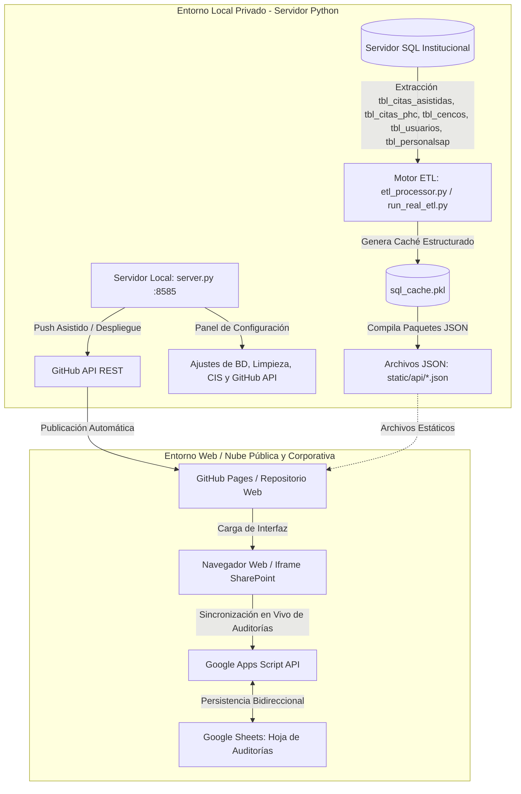
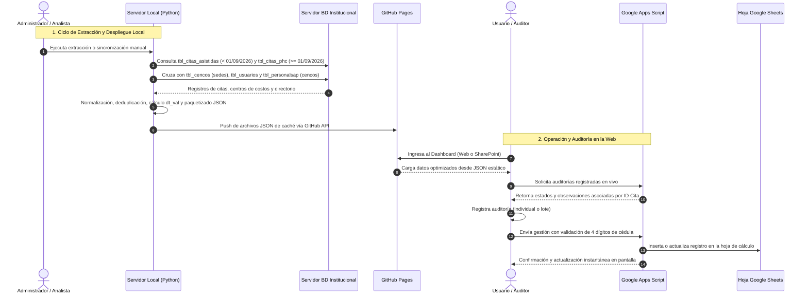

# Sistema Web de Seguimiento a Cierre de Historias Clínicas - AGENDAWEB

Aplicación web interactiva de alto rendimiento desarrollada para la gestión, auditoría y control del cierre de historias clínicas en **Unión para la Salud y la Vida S.A.S.** Esta plataforma reemplaza y amplía las capacidades del informe analítico institucional, proporcionando herramientas operativas de auditoría individual y masiva, filtros dinámicos en cascada, sincronización en tiempo real y una arquitectura desacoplada para despliegue local y en la nube.

---

## 🌟 1. Políticas Institucionales y Reglas de Negocio

El sistema opera bajo lineamientos orientados a la oportunidad, calidad y completitud en el registro de la atención en salud:

1. **Enfoque en Citas Sin Reporte de Atención**:
   - La base de datos y la interfaz se concentran en citas confirmadas/asistidas que no cuentan con evidencia de historia clínica diligenciada o cuyo estado permanece abierto en los sistemas asistenciales (`En progreso` o citas asistidas con `Atendida = NO`).
2. **Dualidad Histórica de Fuentes**:
   - El sistema integra una transición tecnológica clara: el repositorio inmutable anterior al 1 de septiembre de 2026 (descarga desde AgendaWeb) y la plataforma asistencial vigente desde el 1 de septiembre de 2026 (descarga desde PHC con estados explícitos).
3. **Doble Dimensión de Seguimiento Médico (Operativa y Administrativa)**:
   - El seguimiento de historias clínicas se realiza en dos ejes complementarios:
     - **Por Sede de Atención (IPS)**: Responsabilidad operativa del Centro Integral de Salud (CIS) donde ocurrió la cita.
     - **Por Centro de Costos Asignado al Profesional (`CENCOS MÉDICO`)**: Responsabilidad del área administrativa a la que pertenece el facultativo (por ejemplo, *Supernumerarios*, *Médicos de Apoyo*, *Medicina General*). Si un médico asignado al centro de costos de Supernumerarios atiende en la sede Bello y deja una historia en progreso, el caso puede ser filtrado y auditado tanto por la coordinación de Bello (sede operativa) como por la jefatura de Supernumerarios (administración del talento humano).
4. **Estado Institucional del Profesional Asistencial**:
   - En la tabla de profesionales con pendientes se refleja el estado actual del médico (**Activo** vs. **Inactivo**). Esto permite a las jefaturas y auditores contextualizar citas pendientes de meses anteriores frente a personal retirado o que ya no labora en la institución.
5. **Estandarización y Homologación de Sedes (Mapeo Oficial)**:
   - Todo código IPS se traduce a través de la tabla maestra de centros de costos. Aquellas sedes o códigos no registrados en el maestro se rotulan explícitamente como **"No identificada"**, evitando pérdidas de registros y facilitando la depuración del catálogo.
6. **Exclusión de Códigos de Servicio Especiales y Depuración SURACUP**:
   - Se excluyen automáticamente del cómputo y de las tablas aquellos servicios asistenciales o administrativos parametrizados que no requieren el diligenciamiento de una historia clínica estándar (catálogo maestro `Listado_Codigos_Servicios_Seguimiento.xlsx`).
   - Se filtran agendamientos técnicos o administrativos sin paciente correspondiente a códigos SURACUP predefinidos (`502222`, `50222`, `50103`, `94108`, `700000`, `99999`, `236`, `210`, `207`).
7. **Validación de Identidad de Auditores**:
   - Al asentar una auditoría, se exige la **verificación estricta de los 4 últimos dígitos de la cédula del auditor**, previniendo suplantaciones y asegurando la cadena de custodia de la información.
8. **Métricas de Avance y Prevalencia de la Última Gestión**:
   - Para historias clínicas que han sido auditadas en múltiples ocasiones (re-auditorías de seguimiento), el sistema aplica siempre el estado de la **auditoría más reciente** tanto para la clasificación de pendientes activos como para los indicadores de avance por sede y programa.

---

## 🗄️ 2. Modelo de Datos y Tablas SQL Institucionales

El motor de extracción y procesamiento ETL interactúa con un conjunto de tablas estructuradas en el servidor SQL Server institucional, cada una con un rol operativo específico:

| Tabla SQL | Naturaleza | Fuente | Actualización | Rol en el Sistema |
| :--- | :---: | :---: | :---: | :--- |
| **`dbo.tbl_citas_asistidas`** | Histórica | AgendaWeb | **Inmutable** (No recibe datos) | Contiene la información histórica de citas previas al **1 de septiembre de 2026**. No incluye estado textual de la historia clínica; los estados se deducen a partir de si la cita fue confirmada/asistida (`asistida = 'SI'`) y atendida (`atendidoipsa = 'NO'`). |
| **`dbo.tbl_citas_phc`** | Vigente | PHC | **Diaria y Periódica** | Contiene la información vigente de citas desde el **1 de septiembre de 2026 en adelante**. Es la **Fuente de la Verdad** para pendientes contemporáneos, reportando estados explícitos (`En progreso`, `Finalizada`, `Inasistencia`, `Bloqueada`, `Novedad`, etc.). Recibe descargas diarias de días no consolidados y actualizaciones periódicas de estados pendientes. |
| **`dbo.tbl_cencos`** | Maestra | Institucional | Periódica | Catálogo oficial de sedes y centros de costos. Traduce el código numérico del campo `IPS` de `tbl_citas_phc` al nombre oficial estandarizado de la sede. Si un código no existe en la tabla, el sistema lo reporta explícitamente como **"No identificada"**. |
| **`dbo.tbl_usuarios`** | Directorio | Institucional | Continua (Reciente) | Contiene la relación actual de empleados y profesionales asistenciales (activos y retirados). **No es una tabla histórica**, representa la instantánea más reciente del personal. |
| **`dbo.tbl_personalsap`** | Histórica | SAP Nómina | Mensual (Cierre de mes) | Directorio histórico de empleados activos por cada mes con su asignación específica a centros de costos (`desccencos`). Permite habilitar el filtro `CENCOS MEDICO` para auditar médicos según su asignación administrativa independientemente de la sede física de atención. |
| **`dbo.tbl_lidersede`** | *Deprecada* | — | *Sin uso* | **Sin utilidad práctica en el presente programa**. Ha sido formalmente retirada y excluida de todo código, vista y reporte analítico. |

---

## 🏛️ 3. Arquitectura del Sistema: Separación Local vs. Web

La plataforma está diseñada bajo un modelo híbrido que separa estrictamente las tareas administrativas y de extracción pesada (entorno local) del acceso operativo y de consulta para los auditores (entorno web).



### Comparativa de Capacidades por Entorno

| Característica / Función | Servidor Local (`localhost:8585`) | Entorno Web (`GitHub Pages` / `SharePoint`) |
| :--- | :---: | :---: |
| **Conexión Directa a SQL Server** | ✅ Sí (Credenciales protegidas en servidor local) | ❌ No (Zero-backend, máxima seguridad) |
| **Extracción y Procesamiento ETL** | ✅ Sí (Manual o programado) | ❌ No (Consume datos precalculados) |
| **Panel de Configuración (`btnConfig`)** | ✅ Visible (Gestión de conexión, reglas y tokens) | 🔒 Oculto automáticamente por seguridad |
| **Sincronización Manual SQL (`btnManualSync`)** | ✅ Visible (Comprueba firmas de BD) | 🔒 Oculto automáticamente por seguridad |
| **Sincronización de Auditorías en Vivo** | ✅ Sí (Vía API local y Google Sheets) | ✅ Sí (Directo a Google Apps Script) |
| **Auditoría Individual y en Lotes (Masiva)** | ✅ Sí | ✅ Sí |
| **Exportación a Excel** | ✅ Servidor Python (openpyxl nativo) | ✅ Cliente navegador (SheetJS / CSV UTF-8) |
| **Copiado Rápido de Cédula en Iframe** | ✅ Sí | ✅ Sí (Optimizado para SharePoint) |
| **Publicación / Despliegue a GitHub** | ✅ Sí (Push de código y caché con PAT) | ❌ No aplicable |

---

## 🔄 4. Flujo de Datos, ETL y Reglas Operativas



### Campos Registrados en la Bitácora de Auditoría (Google Sheets)
Cada gestión asentada desde la interfaz registra 9 campos trazables:
1. `ID Cita`: Identificador único de la cita en la base de datos de agenda.
2. `Estado Gestión`: Tipificación seleccionada de la auditoría.
3. `Observaciones Auditor`: Justificación o detalle de la gestión realizada.
4. `Auditor / Usuario`: Nombre completo del profesional que auditó.
5. `Cédula Auditor`: Últimos 4 dígitos validados del auditor.
6. `Fecha Gestión`: Estampa de tiempo del momento del registro.
7. `IP Equipo`: Dirección IP origen de la solicitud.
8. `Usuario PC`: Identificador del sistema operativo (en auditorías locales).
9. `Nombre Máquina PC`: Nombre del host de trabajo (en auditorías locales).

### Criterios de Clasificación Operativa:
1. **Citas PHC (desde el 01/09/2026 en `tbl_citas_phc`)**:
   - Si el estado es `'En progreso'`, clasifica como pendiente activa obligatoria.
   - Si registra estado de resolución en PHC (`Finalizada`, `Bloqueada`, `Inasistencia`, `Novedad`, `Reprogramada`, etc.), se excluye de las pendientes activas.
2. **Citas Históricas de AgendaWeb (anteriores al 01/09/2026 en `tbl_citas_asistidas`)**:
   - Clasifican como pendientes aquellas agendadas y asistidas pero sin atención registrada (`asistida = 'SI'` y `atendidoipsa = 'NO'`).
   - Si figuraba como atendida (`atendidoipsa = 'SI'`) o no asistida, no califica como pendiente.
3. **Excepción por Auditoría Registrada**:
   - Cualquier cita auditada y tipificada con resolución/cierre (`Finalizada`, `Historia ya cerrada en sistema`, `Novedad`, `Reprogramada`, `Error de dato`) queda excluida de las listas de pendientes activos.
4. **Prevalencia de la Última Auditoría**:
   - Si una historia clínica fue auditada más de una vez (ej. una primera auditoría la dejó como *En progreso* y en una segunda se confirmó como *Finalizada*), el sistema respeta de manera exclusiva el estado de la **última auditoría realizada**.

---

## 🚀 5. Funcionalidades Principales de la Interfaz

### 1. Filtros Dinámicos en Cascada Multiselección
- **Selector de Período y Rango de Fechas**: Selector de fechas con atajos rápidos (*Último mes*, *Fechas previas*, *Mes actual*, *Todo el año*) que carga bajo demanda los paquetes de datos correspondientes.
- **Filtros Temporales y Organizacionales**: Menús desplegables de selección múltiple con buscador integrado por:
  - *Año*, *Mes*, *Día*, *Quincena*.
  - *Sede (IPS)*: Sede física donde se programó la cita.
  - *Cencos Médico*: Centro de costos asignado administrativamente al profesional (proveniente de `tbl_personalsap`).
  - *Programa asistencial*.
  - *Profesional (Médico)*.
  - *Estado PHC*.
- **Cascada Bidireccional Predictiva**: Al seleccionar uno o varios valores en cualquier filtro, las opciones de los demás filtros se recalculan instantáneamente en memoria, mostrando solo los elementos con citas pendientes reales.
- **Árbol Cronológico de Fechas**: Panel lateral colapsable que desglosa los pendientes por mes y día en tiempo real.

### 2. Tablas Interactivas con Ordenamiento Multiestado
Todas las tablas cuentan con ordenamiento de 3 estados al hacer clic en cualquier cabecera (Ascendente $	o$ Descendente $	o$ Predeterminado):

- **Tabla 1: RESUMEN DE DATOS AGENDAWEB POR SEDES**:
  - Reporta por cada sede el total de pendientes activos en columna **Total pendientes** (total de citas menos descartadas por auditoría).
  - Columna **Confirmada pendiente**: Pendientes confirmados por auditoría (*En progreso* o *Pendiente*).
  - Columna **Sin Auditar**: Calculada como `Total pendientes - Confirmada pendiente`.
  - Columna **% Avance**: Porcentaje de gestión sobre el total de pendientes.
  - Muestra fila de totales consolidados al pie de la tabla.
- **Tabla 2: CITAS CONFIRMADAS SIN REPORTE DE ATENCIÓN POR MÉDICO**:
  - Reporta por profesional:
    - **Profesional**: Nombre del médico.
    - **Identificación**: Cédula con botón de copiado rápido a 1 clic.
    - **Sede**: Sede principal de atención.
    - **Estado**: Badge de estado institucional actual (**Activo** en verde / **Inactivo** en gris/rojo) alimentado desde `tbl_usuarios` y `tbl_personalsap`.
    - **Pendientes**: Número exacto de historias pendientes activas del profesional en el período seleccionado.
- **Tabla 3: PENDIENTES POR FECHA**:
  - Desglose cronológico jerárquico por mes y día.
- **Tabla 4: DETALLE DE CITAS CONFIRMADAS SIN REPORTE DE ATENCIÓN**:
  - Pendientes activos con descripción de fecha, hora, sede, documento, tipo de documento, paciente, programa, médico, estado actual en PHC y botón de auditoría (`Auditar` / `Editar`).
  - **Copiado de Cédula a 1 Clic**: Compatible con entornos restringidos e iframes de Microsoft SharePoint.

### 3. Tarjetas Informativas de la Sección "Seguimiento y Tablas"
1. **Total pendientes**: Número de historias pendientes **ACTIVAS** del período seleccionado.
2. **Médicos con pendientes**: Cantidad de profesionales asistenciales que presentan pendientes **ACTIVOS**.
3. **Sede con mayor rezago**: Sede con el mayor número de pendientes **ACTIVOS**.
4. **% Avance de auditoría**: Proporción de citas gestionadas frente al total de reportes pendientes.
5. **Historias Auditadas**: Reporte de auditorías realizadas en el período seleccionado según la **fecha de gestión**.

### 4. Gráficos y Tarjetas de la Sección "Dashboard de Análisis"
- **Resultados de Auditoría**: Clasificación final asignada por los auditores según fecha de consulta.
- **Gestión por Auditor**: Conteo de gestiones efectuadas por cada auditor según fecha de gestión.
- **Pendientes por Programa e Inconsistencias**: Distribución de pendientes y tasa de divergencias o errores en programas.
- **Avance Mensual y por Sede**: Barras apiladas con porcentaje o conteo de avance.
- **Resolutividad Post-Auditoría**: Monitoreo de casos confirmados inicialmente como abiertos que fueron posteriormente cerrados.
- **Histórico de Registros en Progreso**: Evolución porcentual de casos 'En progreso' por meses, sedes y profesionales.

---

## ⚡ 6. Motor de Alto Rendimiento y Optimización de Consultas

Para soportar consultas de amplio espectro temporal (por ejemplo, consolidaciones multimensuales de más de 20.000 citas) sin congelamiento del navegador:

1. **Precomputación Numérica de Fechas (`dt_val`)**:
   - Cada cita incluye su timestamp de época precomputado en milisegundos (`dt_val = (año * 10000 + mes * 100 + dia) * 86400000 + hora_ms`).
   - El ordenamiento de la tabla de detalles opera como una comparación matemática pura en $O(N \log N)$ ejecutada en menos de **4 ms**, eliminando el análisis sintáctico iterativo de cadenas de texto de fecha (que generaba demoras de hasta 30 a 60 segundos).
2. **Web Worker Dedicado (`worker.js`)**:
   - El filtrado multifactorial en cascada se ejecuta en un hilo de fondo (*background thread*), manteniendo la interfaz de usuario fluida y receptiva a 60 FPS en todo momento.
3. **Indexación Perezosa (Lazy Maps)**:
   - Los mapas de búsqueda por ID de cita (`_citasByIdMap`) se construyen únicamente bajo demanda, evitando consumo innecesario de CPU y memoria en cargas iniciales.

---

## 📁 7. Inventario y Función de Cada Archivo del Programa

### A. Archivos Maestros y de Parametrización
* **`Listado_Codigos_Servicios_Seguimiento.xlsx`**: Catálogo oficial de códigos de servicio, nombres de programa, servicios asistenciales y criterios de exclusión.
* **`config.json`**: Parámetros públicos: webhook de Google Apps Script, reglas ortográficas (`text_cleaning_rules`) y homologación CIS.
* **`db_config.json`** *(Privado, excluido por `.gitignore`)*: Credenciales de conexión ODBC a SQL Server institucional y token de GitHub.
* **`db_config.example.json`**: Plantilla modelo pública sin credenciales reales.

### B. Aplicación Web Frontend (Interfaz de Usuario)
* **`index.html`**: Estructura principal SPA (*Single Page Application*) servida desde la raíz para GitHub Pages.
* **`version.json`**: Metadatos de versión y actualización para recarga de caché.
* **`static/app.js`**: Controlador cliente principal: filtros en cascada, auditorías, integración con IndexedDB y renderizado optimizado.
* **`static/worker.js`**: Web Worker en segundo plano para filtrado en memoria sin bloqueo de UI.
* **`static/styles.css`**: Hoja de estilos institucionales, diseño adaptativo y temas claro/oscuro.
* **`static/index.html`**: Espejo sincronizado para despliegues con rutas relativas alternativas.
* **`static/logo_blanco.png`**: Isotipo institucional de alta resolución.

### C. Paquetes de Datos JSON Precalculados (`static/api/`)
* **`static/api/dashboard_ultimo_mes.json`**: Dataset optimizado del último mes para carga rápida móvil.
* **`static/api/dashboard_fechas_previas.json`**: Dataset histórico de meses y vigencias anteriores.
* **`static/api/dashboard_ambos.json`**: Consolidado unificado multimensual.
* **`static/api/dashboard.json`**: Paquete consolidado de respaldo.
* **`static/api/feedback.json`**: Registro inicial de auditorías históricas.

### D. Motor Backend, ETL y Sincronización Local
* **`server.py`**: Servidor local Python (HTTP :8585) para gestión de auditorías, panel de administración y control de despliegue.
* **`run_real_etl.py`**: Ejecutor de consola del proceso de Extracción, Transformación y Carga (ETL).
* **`etl_processor.py`**: Algoritmos de consulta SQL (`tbl_citas_asistidas`, `tbl_citas_phc`, `tbl_cencos`, `tbl_usuarios`, `tbl_personalsap`), limpieza y compilación JSON.
* **`google_sheets.py`**: Módulo de sincronización con la API de Google Apps Script y publicación a GitHub.
* **`feedback_store.json`**: Almacén maestro local de auditorías de contingencia.
* **`sql_cache.pkl` / `tbl_usuarios_all.pkl`** *(Privados, excluidos por `.gitignore`)*: Cachés binarios locales de datos SQL para acelerar el ETL local.
* **`db_signature.json` y `sql_signature.json`** *(Privados, excluidos por `.gitignore`)*: Firmas de control de cambios de bases de datos.
* **`google_apps_script_template.js`**: Código modelo para desplegar el backend en Google Drive como Web App.

---

## 🌐 8. Política de Publicación en GitHub y Despliegue Online

Para el funcionamiento en **GitHub Pages** y en el visor de **SharePoint**, el repositorio requiere únicamente:

```text
├── index.html                           # Estructura principal de la aplicación web
├── .nojekyll                            # Obligatorio: desactiva Jekyll en GitHub Pages
├── version.json                         # Control de versión
├── Listado_Codigos_Servicios_Seguimiento.xlsx # Catálogo maestro de servicios
├── config.json                          # Parámetros públicos y URLs de Google Apps Script
├── README.md                            # Documentación técnica institucional
└── static/
    ├── app.js                           # Lógica cliente y filtros
    ├── worker.js                        # Procesamiento en segundo plano
    ├── styles.css                       # Hoja de estilos institucionales
    ├── logo_blanco.png                  # Logotipo corporativo
    ├── version.json                     # Verificación de versión relativa
    ├── index.html                       # Respaldo de acceso por ruta relativa
    └── api/
        ├── dashboard_ultimo_mes.json    # Caché período actual
        ├── dashboard_fechas_previas.json# Caché períodos anteriores
        ├── dashboard_ambos.json         # Caché consolidado
        ├── dashboard.json               # Caché respaldo
        └── feedback.json                # Bitácora de auditorías
```

### 🔒 Archivos que NUNCA deben subirse a GitHub (Seguridad y Privacidad)
1. **`db_config.json`**: Contiene credenciales del servidor SQL institucional y tokens personales de GitHub.
2. **`sql_cache.pkl` y `tbl_usuarios_all.pkl`**: Archivos binarios locales con miles de registros clínicos protegidos por Habeas Data.
3. **`db_signature.json` y `sql_signature.json`**: Metadatos de control interno local.
4. **`feedback_store.json`**: Almacén local temporal de notas.

---

## 💻 9. Guía de Puesta en Marcha

### A. Servidor Local (Entorno de Administración)
1. Instalar Python 3.10+ y dependencias:
   ```bash
   pip install pandas numpy pyodbc openpyxl requests
   ```
2. Configurar `db_config.json` con base en `db_config.example.json`.
3. Iniciar el servidor local:
   ```bash
   py -u server.py
   ```
4. Acceder en el navegador a **`http://localhost:8585`**.

### B. Despliegue en GitHub Pages (Entorno Web de Auditores)
1. Confirmar cambios y sincronizar el repositorio en GitHub.
2. En GitHub ➔ **Settings** ➔ **Pages**:
   - **Source**: `Deploy from a branch`
   - **Branch**: `main` / `/(root)`
3. La aplicación estará accesible en: `https://<organizacion>.github.io/<repositorio>/`.

### C. Backend en Google Apps Script
1. Crear una hoja de cálculo en Google Drive.
2. En **Extensiones ➔ Apps Script**, copiar [`google_apps_script_template.js`](file:///g:/Mi%20unidad/Programas/Desarrollos/Seguimiento%20Agendaweb/Cierre%20de%20historias/google_apps_script_template.js).
3. Implementar como aplicación web con acceso *Cualquier persona* y actualizar la URL en `config.json`.

---

## 🛡️ 10. Seguridad, Habeas Data y Buenas Prácticas

- **Cumplimiento de Protección de Datos Personales (Ley 1581 de 2012)**: La versión pública en GitHub Pages y SharePoint opera con datasets agregados y procesados, excluyendo diagnósticos médicos y notas clínicas reservadas.
- **Validación de Identidad Asistencial**: Registro estricto de cédula de auditor y trazas de tiempo para auditorías médico-legales.
- **Aislamiento de Credenciales**: No se almacenan contraseñas ni cadenas de conexión en el frontend ni en repositorios remotos.
